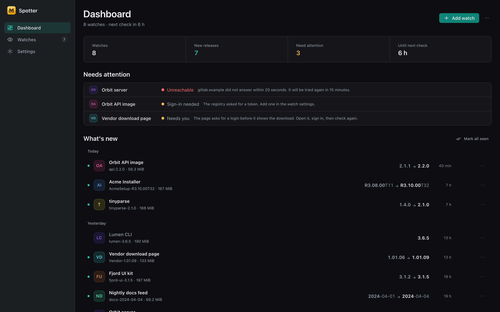
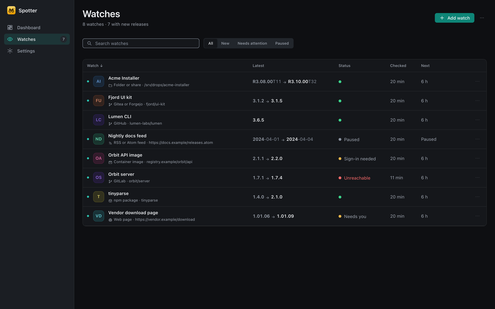
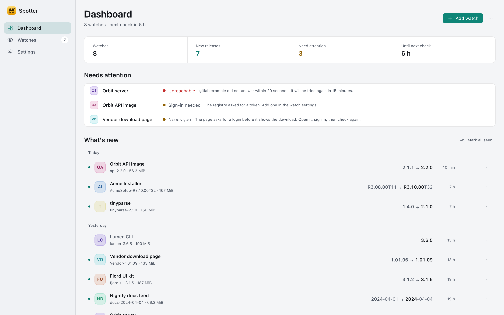
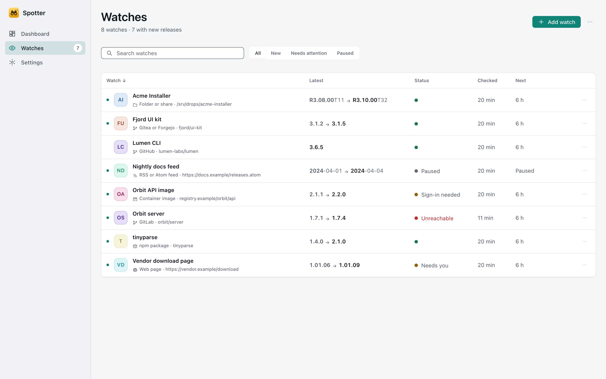

# Spotter

Spotter watches for new releases anywhere and tells you the moment one appears. It is a desktop app (Windows, macOS,
Linux) from the Paddock suite, and it is **local only**: no cloud, no account, no telemetry. Everything it learns stays
in a local database on your machine.


## What it watches

Each watch is a source of a given kind, plus filters (channels, pre-releases, version scheme) and a schedule:

- folders and network shares
- HTTP directory listings
- JSON APIs
- forges (releases and tags)
- RSS and Atom feeds
- web pages, including pages that only show their content after JavaScript runs (a supervised Chromium renders them;
  logins and captchas are handed to you as "Needs you", never solved automatically)

Presets and version schemes are declarative TOML packs, so adding a product is configuration, not code. Spotter
orders versions, applies your filters and soak time, shows what changed, and notifies you (with digests and quiet
hours) through the OS.

## Platforms

Windows (NSIS installer), macOS (`.dmg`) and Linux (`.deb`, AppImage). Built with a Rust core, Tauri 2 and an Angular UI.

## Build and run

```sh
cd app && npm ci
npm start                              # UI with the mock backend in the browser (http://localhost:4200)
npx tauri dev                          # the desktop app with hot reload
cargo test --workspace                 # engine tests
PW_PORT=4370 npx playwright test --workers=1   # browser flows (Spotter uses port 4370, not the default)
```

Use `CARGO_BUILD_JOBS=2` and a private `CARGO_TARGET_DIR` on a shared machine. Full instructions, quality gates and
load rules are in [docs/development.md](docs/development.md); releases in [docs/releasing.md](docs/releasing.md).

## Screenshots

1440x900 at 2x, dark and light (`SCREENSHOTS=1 npx playwright test --project=screenshots` in `app/`, against the mock backend with invented data).

| Dashboard | Watches |
| --- | --- |
|  |  |
|  |  |

Also in `docs/screenshots`: release cadence, watch detail (with the release panel and a multi-product watch), the add-watch wizard, settings, the tray popup and the empty states.

## Diagrams

Drawn with the Paddock diagram kit (see [docs/diagrams/STYLE.md](docs/diagrams/STYLE.md)); the `.drawio` sources and generators
are in [docs/diagrams/](docs/diagrams/). They follow your light or dark setting.

- [System context](docs/diagrams/svg/c4-1-context.svg) and [containers](docs/diagrams/svg/c4-2-containers.svg) (C4 levels 1 and 2)
- [Engine components](docs/diagrams/svg/c4-3-engine.svg) (C4 level 3)
- [A scheduled check finds a new release](docs/diagrams/svg/uml-seq-check-release.svg) and
  [a rendered page watch and "Needs you"](docs/diagrams/svg/uml-seq-rendered-page.svg) (sequences)
- [Watch status](docs/diagrams/svg/uml-state-watch.svg) (state machine)
- [Ports and their adapters](docs/diagrams/svg/uml-class-ports.svg) (classes)
- Deployment on [Windows](docs/diagrams/svg/uml-deployment-windows.svg), [macOS](docs/diagrams/svg/uml-deployment-macos.svg)
  and [Linux](docs/diagrams/svg/uml-deployment-linux.svg)

## Documentation

- [docs/development.md](docs/development.md) - building, testing, CI
- [docs/releasing.md](docs/releasing.md) - tags, signed updates
- [docs/adr/](docs/adr/) - architecture decisions
- [docs/roadmap.md](docs/roadmap.md) - state and known gaps
- [docs/suite-lessons.md](docs/suite-lessons.md) - lessons shared across the suite
- [AGENTS.md](AGENTS.md) - engineering rules for contributors

## Licence

MIT OR Apache-2.0 ([LICENSE-MIT](LICENSE-MIT), [LICENSE-APACHE](LICENSE-APACHE)).
