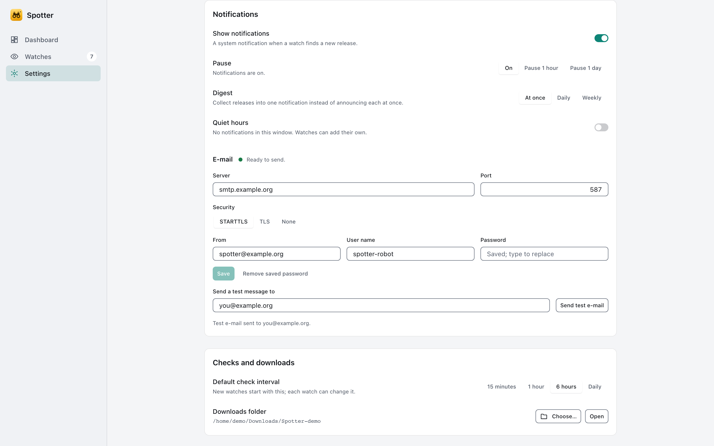
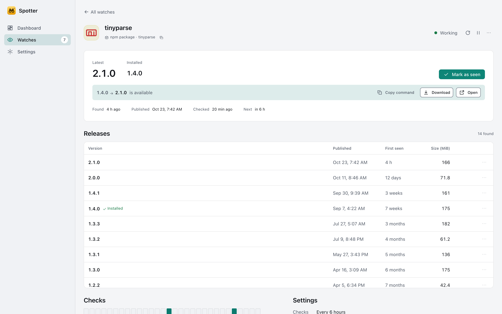

# Features added in the engine round

What each feature does for a user, and what Spotter does not do.

## Pictures for watches
Each watch shows the picture of the thing it watches: the owner's avatar for GitHub and Gitea/Forgejo repositories, the
site's favicon for feeds, pages, directory listings and JSON APIs. Spotter asks the watched site only, at most once a
week per picture, and never a favicon service. Folders, package registries and container images use Spotter's own mark
for their kind. Offline, or when a site has no usable picture, the last picture (or the mark, or the monogram) stays.
Only small, plain images are accepted; scripts and external references in SVG files are refused.

## E-mail notifications
Add an e-mail channel to a watch (an address) and set up the mail server once under Settings: server, port, security
(STARTTLS for port 587, TLS for port 465, "None" only for a relay on a trusted network), account and sender. The password
is kept in the system credential store. "Send test" sends a message through the saved settings and, when it fails, says
what to check (server unreachable, secure connection refused, account not accepted, address refused, no answer in
time). Mail is sent for new releases of watches that have the channel; failures appear in the journal as "notify" failures.

## Safer address checks
A watch that is not marked local cannot reach this computer or its local link even if a name changes its answer between
the check and the connection (DNS rebinding).

## Install commands
For container tags and package versions (crates.io, npm, PyPI, NuGet) each release carries a command you can copy
(`docker pull image:tag`, `npm install name@version`, ...). Spotter never runs it. Other sources have none, because what
to install depends on the platform. The watch's detail page shows a Copy command button on the upgrade line.

